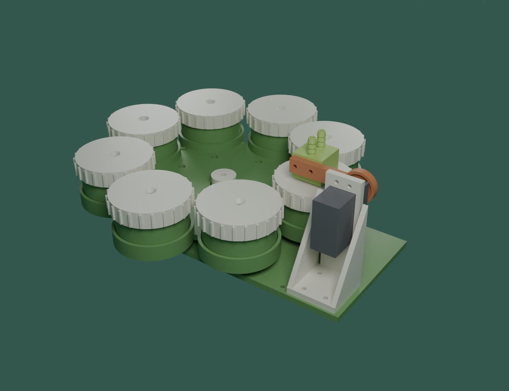

# eDNA Pod — carousel, nozzle and base (v1)

These are the printed parts around the test cartridges in [`../cartridge`](../cartridge). The **carousel** holds 8 cartridges and is turned by the stepper motor. The **nozzle** is pressed onto one cartridge at a time by the servo. The **base plate** holds the motor and the servo tower, and catches the water that drips through.

| File | Print | What it is |
|---|---|---|
| `carousel_quarter.stl` | **4** | A quarter of the carousel with 2 cartridge seats. The carousel is 246 mm across, too big for a 220 mm bed, so it is printed in quarters. |
| `carousel_hub.stl` | 1 | Fits on the motor shaft (5 mm D-shaft). The 4 quarters bolt onto its 140 mm flange. |
| `nozzle_block.stl` | 1 | Two hose barbs on top (sample water and ethanol) join into one hole underneath. A silicone gasket sits in the recess on the bottom and seals onto the cartridge cap. |
| `nozzle_arm.stl` | 1 | Joins the servo horn to the nozzle block. |
| `servo_tower.stl` | 1 | Holds the MG996R servo beside the carousel. |
| `base_plate.stl` | 1 | Motor mount, tower bolt holes, waste collector with an outlet hole, holes for the home sensor, 4 mounting holes. |
| `make_pod.py` | – | The Blender script that builds all of these. Change the numbers at the top and run it again. |
| `pod.blend` | – | Blender file with the full assembly (8 cartridges, plus rough motor and servo blocks) and the parts in print position. |
| `preview_*.png` | – | Renders. `preview_nozzle_up.png` shows the nozzle lifted. |

## Key sizes

- 8 seats on a 182 mm circle (seat centres are 91 mm from the middle). Each seat pocket is 59 mm wide, 0.5 mm wider than the cartridge, and 8 mm deep. There is a 14 mm drain hole under every seat.
- Carousel: 246 mm across, 13 mm tall at the seat rings.
- Whole Pod inside the box: about **285 × 250 mm**, and about 150 mm tall including the motor under the plate. This does **not** fit the 22 cm canister. Use a bought IP67 box of at least 300 × 260 × 160 mm inside.
- Nozzle: the gasket face is 52 mm above the base plate when pressed down. The servo shaft is 138 mm from the middle, at 66 mm high.

## Printing (school printer, 220 × 220 mm bed)

- **Material:** PETG, 0.2 mm layers, 4 walls, 30 % infill, 235 °C nozzle, 80 °C bed. No supports for any part.
- Each STL is already lying in its print position.
- The base plate is 192 × 112 mm, and each quarter is 118 × 128 mm. Everything fits the bed.
- **Rough print times:**
  - Quarters: about 2.5 h each, so about 10 h for all 4.
  - Hub: about 3.5 h.
  - Base plate: about 4 h.
  - Tower: about 1.5 h.
  - Nozzle block: about 1 h.
  - Arm: about 30 min.
  - Total about 21 h, plus the 8 cartridges.

## Parts to buy

| Item | How many |
|---|---|
| M3 × 10 bolts + M3 nuts | 8 (quarters to hub; the nuts go in the hex pockets under the flange) |
| M3 × 10 bolts + M3 nuts | 4 (tower to base plate) |
| M3 × 12 bolts + M3 nuts | 4 (servo to tower) |
| M3 × 16 screws | 2 (arm into the nozzle block; they cut their own thread in the PETG) |
| M3 × 6 screws | 4 (motor under the base plate) |
| M3 heat-set insert (4 mm hole) + M3 × 6 grub screw | 1 + 1 (locks the hub on the flat side of the shaft) |
| 8 × 5 mm neodymium disc magnet (TechMaze, AED 2.10) | 1 |
| Hall sensor module (A3144 or KY-003) | 1 |
| 3 mm silicone sheet, cut a 16 mm disc with a 4 mm hole | 1 small piece |
| 6 mm inside-diameter silicone tube | about 1 m |
| 9.5 mm outside-diameter tube or bulkhead fitting | 1 (waste outlet) |
| M3 standoffs | 4 (to lift the plate off the box floor; the motor hangs underneath) |

## Putting it together

1. Screw the motor under the base plate. Push the hub onto the shaft, with the insert facing the flat side, and tighten the grub screw.
2. Bolt the 4 quarters onto the hub flange.
3. Every quarter has a magnet pocket underneath (8.3 mm wide, 4 mm deep), but **glue the 8 × 5 mm magnet into one pocket only**. It stands 1 mm proud of the underside, which is fine. The seat next to it is **seat 1**.
4. Mount the Hall sensor on its two holes, with spacers, so it sits 2–3 mm under the magnet (remember the magnet sticks out 1 mm).
5. Bolt the tower to the base plate *before* fitting the servo, because the servo covers the screws. Then bolt the servo through the window.
6. Screw the arm onto the servo horn and the nozzle block. Push the gasket into the recess and fit the two tubes onto the barbs.

## Numbers to tune (top of `make_pod.py`)

- **`flat`** — how tight the hub is on the D-shaft. Raise it by 0.1 if the hub won't go on; lower it if it wobbles.
- **`seat_clear`** — how loose the cartridge is in its seat.
- **`sv_holes`, `horn_above_tab`, `horn_r`** — servo size. Measure your MG996R first, because copies differ by about 1 mm. `horn_above_tab` is the distance from the servo's mounting-tab face to the face of the horn.
- **`gasket_out`** — how far the gasket sticks out below the block, which sets how hard it presses.
- **`seats`** — set this to 6 for a one-piece carousel (204 mm across), which prints as a single `carousel.stl`. It holds 6 cartridges instead of 8.

## Firmware changes this design needs

- **Servo angles:**
  - The nozzle only needs to lift about 20° to clear the caps (about 13 mm).
  - Set `SERVO_DOWN` so the gasket just squashes, then set `SERVO_UP` about 20 higher (for example `SERVO_DOWN = 95`, `SERVO_UP = 75`).
  - Don't use the old 75° swing: at that angle the nozzle points across the carousel and would spray onto the other cartridges.
- **PRIME and RINSE:**
  - Turn the carousel half a seat (`STEPS_PER_SEAT / 2`) so the nozzle is over a **waste slot** before you flush the hose. Otherwise old water lands on a clean cartridge.
  - The slots are between seats 8 & 1, 2 & 3, 4 & 5, and 6 & 7, so every seat has a slot on one side. Seats 1, 3, 5 and 7 have their slot on the seat-8 side; seats 2, 4, 6 and 8 have theirs on the other side. Check once by hand which way the motor has to turn for each.
- `STEPS_PER_SEAT = 400` is still right for 8 seats with 16 microsteps.

Not yet printed or tested. Photograph every version for the Engineering Notebook, and write down what you changed.
